# Quiltor

[Deutsch](README.md) · [English](README.en.md)

> ## You write the story. Quiltor holds the world together.

[](https://quiltor.app)
[](https://github.com/Tim3399/quiltor/releases)
[](https://github.com/Tim3399/quiltor/actions/workflows/test.yml)
[](#status-and-license)

**[Open Quiltor in the browser → quiltor.app](https://quiltor.app)** · [Download](https://github.com/Tim3399/quiltor/releases) · [Quick start](#quick-start) · [Further reading](#further-reading)

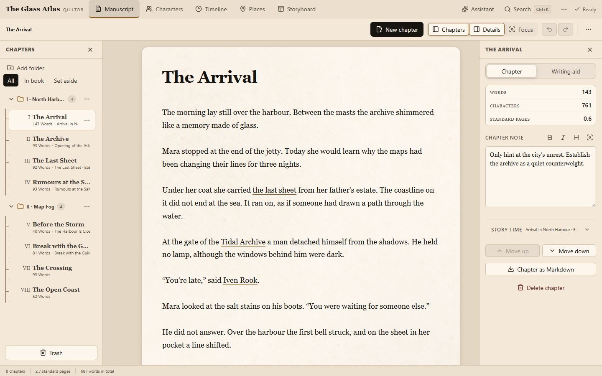

## What Quiltor is

Quiltor is a writing environment for novels and other long fiction. Manuscript, characters, relationships, places, timeline and storyboard form one shared world instead of being spread across several applications.

A local assistant knows that world: it searches it, answers questions with sources and proposes structured changes that you confirm yourself.

> [!NOTE]
> **The assistant writes no prose.** It deliberately has no tool to write, continue or rewrite novel text. You write every sentence; Quiltor helps with the work around writing.

Quiltor is local-first. Every world is its own database on your computer, needs no account and no subscription, and works without the internet. Cloud sync and the assistant are optional.

## A tour in pictures

### Manuscript

Chapters in nested folders, a quiet editor with focus mode and chapter notes. Mentions of characters and places lead straight to the world element.

### Characters and relationships

Characters, places, organisations and objects live in one shared graph. Relationships can be directed and can change as the story goes on.

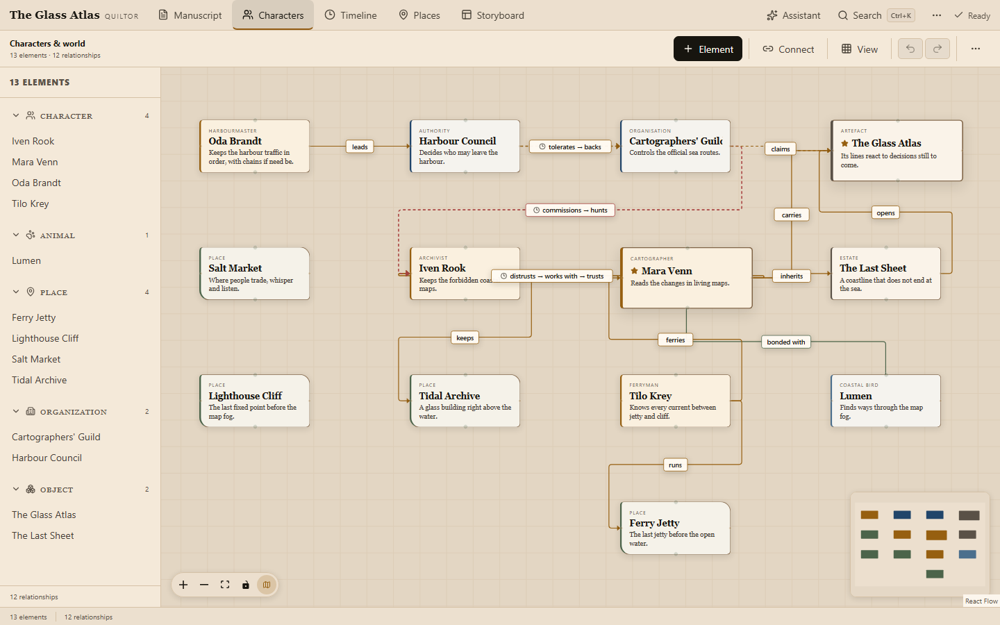

### Timeline

At the chosen moment the graph shows who works together and who is where. Flashbacks in the manuscript do not move the world's chronology.

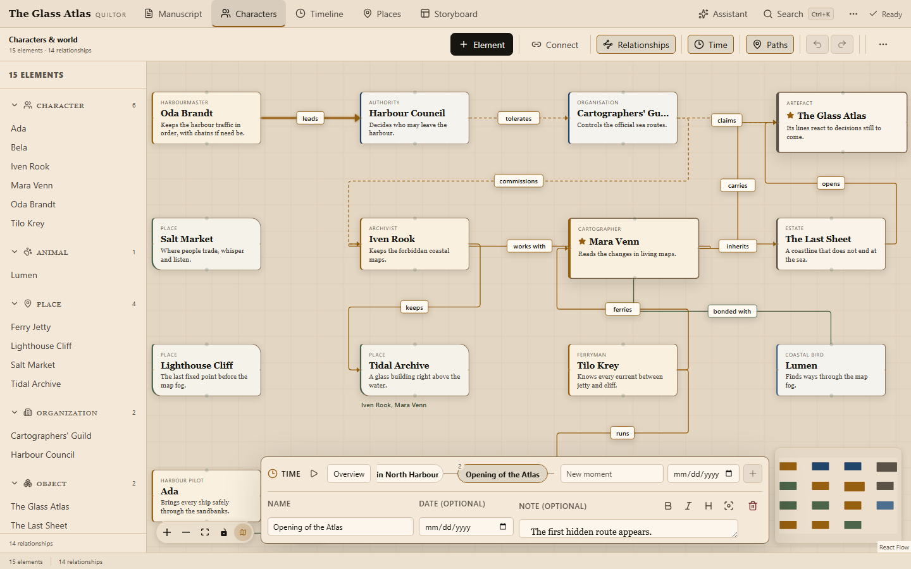

The timeline page maintains moments, notes, relationship states and life events. Every moment shows which chapters use it.

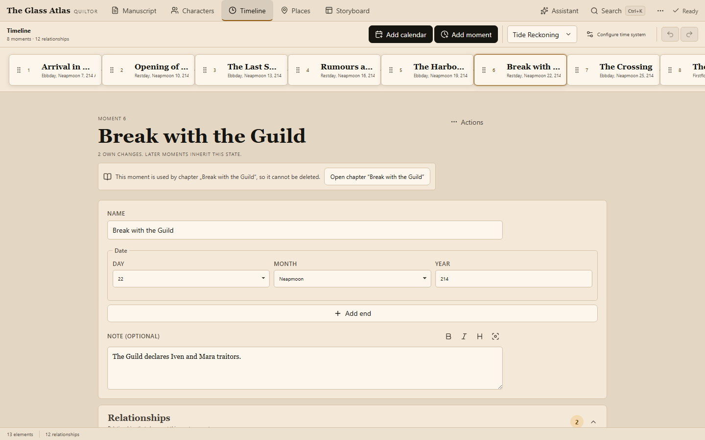

Besides relative time and Gregorian dates there are custom calendars with named months, weekdays and an era. Switching the calendar does not change the order of events.

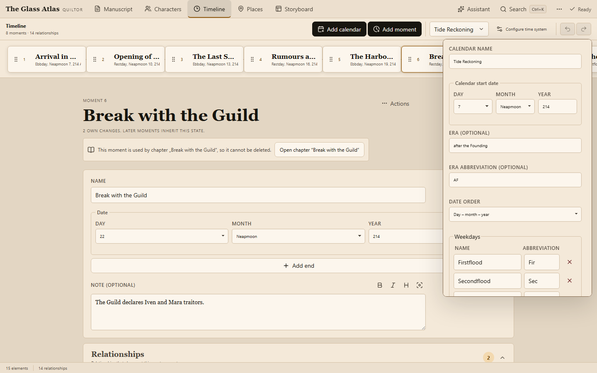

### Places and maps

Places stand on a map of their own, and a ruler measures distances in your scale. The timeline turns into stay chronicles and journeys.

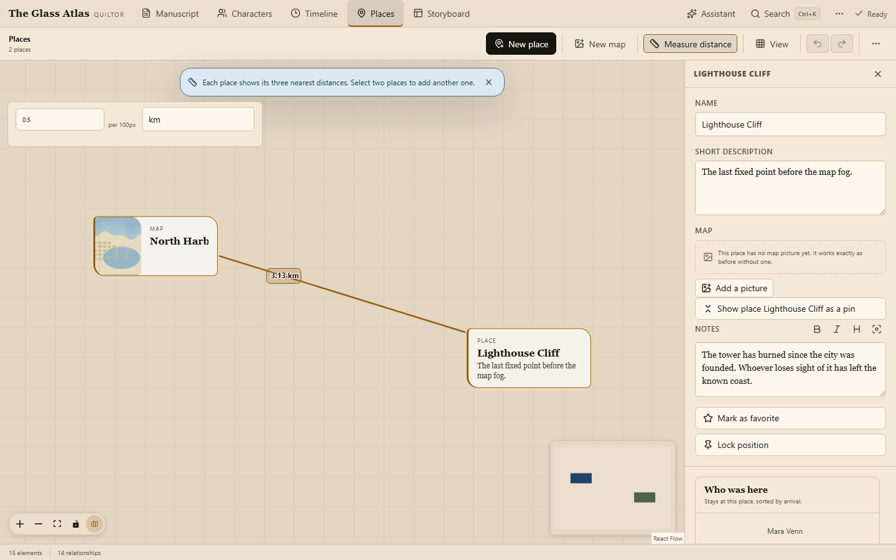

Every place is also a level. On a map picture of its own, such as a city plan, you set the places inside it as pins or cards.

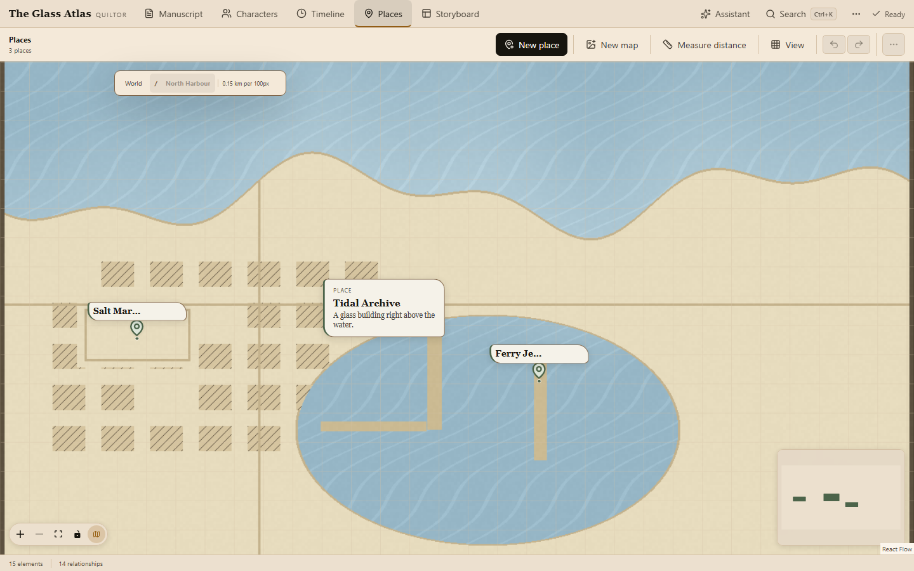

### Storyboard

Several boards with notes, reference cards, groups and connections. Planning stays planning: a connection on the board creates no relationship in the world.

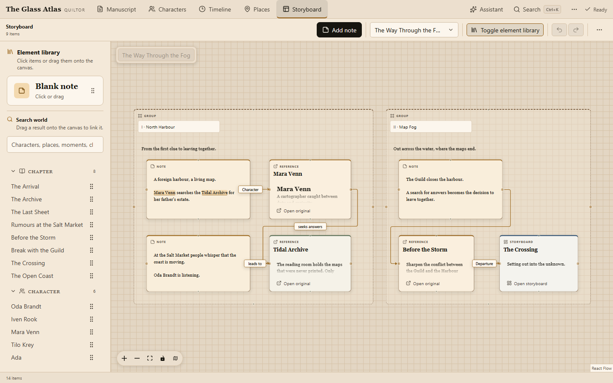

### One note everywhere

Chapters, world elements, timeline moments and storyboard cards share one note editor. `@` references survive renames, and backlinks show where something is used.

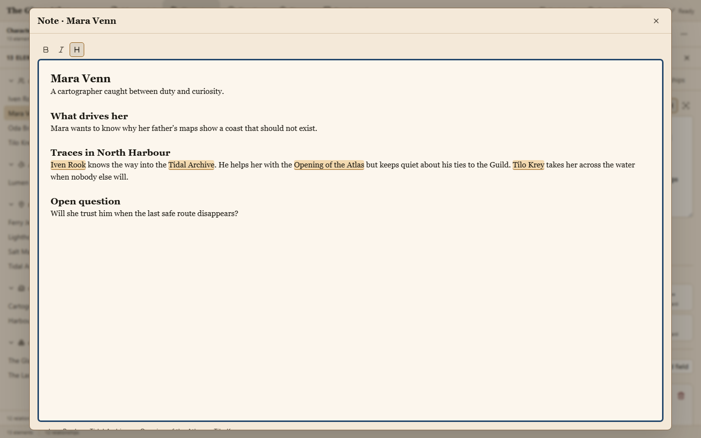

### Search

One search across chapters, text, notes, characters, places, moments and storyboards. Results show their folder and where the text matched.

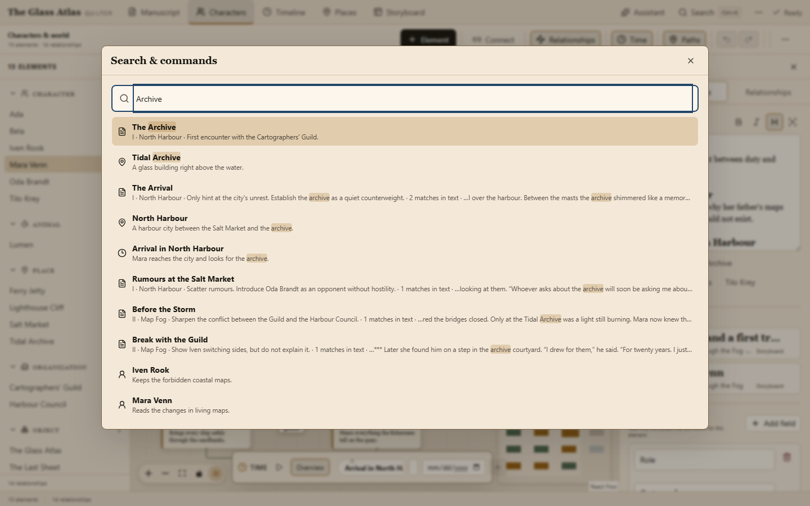

### Versions

You save versions with a short note and compare them word by word with the current state. Every version can be restored.

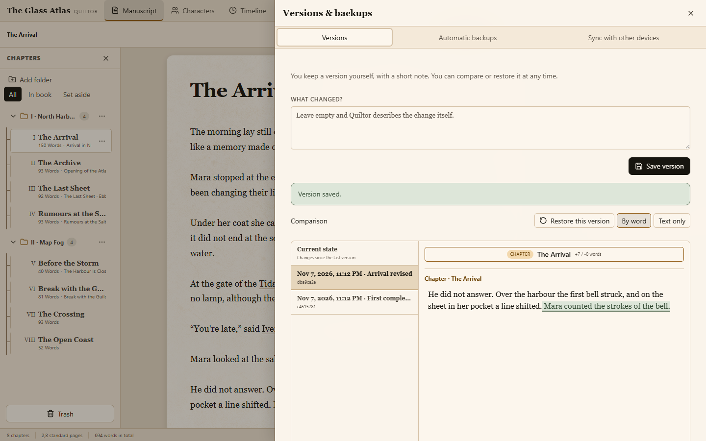

## Quick start

> [!TIP]
> The fastest way to try it: open **[quiltor.app](https://quiltor.app)** in the browser.

- **In the browser:** open [quiltor.app](https://quiltor.app) and create a new world. The project data then lives on that server.
- **Desktop app:** download the package for macOS (Apple Silicon) or Windows from the [releases](https://github.com/Tim3399/quiltor/releases). The [first steps](https://github.com/Tim3399/quiltor/blob/main/docs/GETTING-STARTED.md) walk through installation and the first tasks.
- **Run it yourself:** with Python 3.12+ from source or with Docker. Details are in [installation and operation](https://github.com/Tim3399/quiltor/blob/main/docs/operations/installation.md).

```bash
git clone https://github.com/Tim3399/quiltor.git
cd quiltor
python3 apps/web/server.py
```

Quiltor then opens `http://localhost:8000`. On Windows: `py -3.12 apps/web/server.py`. Startup downloads no model; you set up the assistant explicitly later.

## Your data

Running locally, everything stays on your computer: every world is its own SQLite database with automatic backups and version history. Syncing with other devices only happens when you click, and only through a backup endpoint you enter, for example `https://backup.quiltor.app`. What lives where is described in [sync, backup and local data](https://github.com/Tim3399/quiltor/blob/main/docs/operations/sync-and-backup.md).

## Who it is for

For authors who write themselves and are not looking for an AI ghostwriter. Especially for long novels and series with many characters, places and timelines.

## Further reading

- [First steps](https://github.com/Tim3399/quiltor/blob/main/docs/GETTING-STARTED.md)
- [Features in detail](https://github.com/Tim3399/quiltor/blob/main/docs/features.md)
- [Installation and operation](https://github.com/Tim3399/quiltor/blob/main/docs/operations/installation.md): source, Python package, desktop, Docker, CLI
- [The local assistant](https://github.com/Tim3399/quiltor/blob/main/docs/assistant.md): runtime, external endpoint, MCP
- [Own AI](https://github.com/Tim3399/quiltor/blob/main/docs/operations/own-ai.md): AI in the browser (WebLLM) instead of the server AI, switch, deadlines, reverse proxy and Content Security Policy
- [German writing tools](https://github.com/Tim3399/quiltor/blob/main/docs/writing-tools.md)
- [Sync, backup and local data](https://github.com/Tim3399/quiltor/blob/main/docs/operations/sync-and-backup.md)
- [Development](https://github.com/Tim3399/quiltor/blob/main/docs/development.md) and [architecture](https://github.com/Tim3399/quiltor/blob/main/docs/architecture/overview.md)
- [Roadmap](https://github.com/Tim3399/quiltor/blob/main/docs/TODO.md)

## Status and license

Quiltor is under active development. The current five-workspace workflow is
implemented; deeper evidence/provenance, persistent findings, incremental analysis, and
dedicated AI storyboard workflows are tracked in the [roadmap](https://github.com/Tim3399/quiltor/blob/main/docs/TODO.md).

Quiltor is **source-available, not open source**. The source is public, modifiable, and redistributable, while commercial use by larger organizations is restricted.

It is offered under your choice of:

- [PolyForm Noncommercial License 1.0.0](https://polyformproject.org/licenses/noncommercial/1.0.0)
- [PolyForm Small Business License 1.0.0](https://polyformproject.org/licenses/small-business/1.0.0)

See [LICENSE](LICENSE).

### Free without asking

- noncommercial use: personal projects, hobby work, study, teaching, research, charities, and public institutions
- commercial use under the PolyForm Small Business License: fewer than 100 employees/independent contractors and less than USD 1,000,000 total revenue in the previous tax year

Self-employed authors are effectively always within the small-business threshold.

Commercial use above that threshold requires an individual agreement:

**<tim.ratermann@outlook.de>**

Details: [COMMERCIAL.md](COMMERCIAL.md)

The summary is not binding; the English license text in [LICENSE](LICENSE) governs.

Release packages additionally contain third-party software and model weights under their own licenses. See [THIRD-PARTY-NOTICES.md](THIRD-PARTY-NOTICES.md).
