# Quiltor

[Deutsch](README.md) · [English](README.en.md)

> ## Du schreibst die Geschichte. Quiltor hält die Welt zusammen.

[](https://quiltor.app)
[](https://github.com/Tim3399/quiltor/releases)
[](https://github.com/Tim3399/quiltor/actions/workflows/test.yml)
[](#status-und-lizenz)

**[Quiltor im Browser öffnen → quiltor.app](https://quiltor.app)** · [Download](https://github.com/Tim3399/quiltor/releases) · [Schnellstart](#schnellstart) · [Weiterlesen](#weiterlesen)

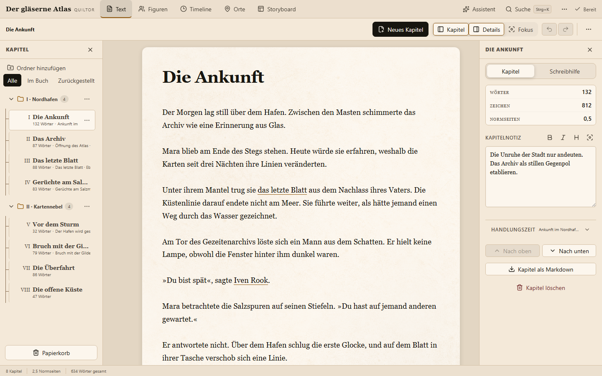

## Was Quiltor ist

Quiltor ist eine Schreibumgebung für Romane und andere lange fiktionale Projekte. Manuskript, Figuren, Beziehungen, Orte, Timeline und Storyboard bilden eine gemeinsame Welt, statt über mehrere Anwendungen verteilt zu sein.

Ein lokaler Assistent kennt diese Welt: Er durchsucht sie, beantwortet Fragen mit Quellen und schlägt strukturierte Änderungen vor, die du selbst bestätigst.

> [!NOTE]
> **Der Assistent schreibt keine Prosa.** Er besitzt bewusst kein Werkzeug, um Romantext zu schreiben, fortzusetzen oder umzuschreiben. Du schreibst jeden Satz; Quiltor hilft bei der Arbeit rund ums Schreiben.

Quiltor ist local-first. Jede Welt liegt als eigene Datenbank auf deinem Rechner, braucht kein Konto und kein Abo und funktioniert ohne Internet. Cloud-Abgleich und Assistent sind optional.

## Rundgang in Bildern

### Manuskript

Kapitel in verschachtelten Ordnern, ein ruhiger Editor mit Fokusmodus und Kapitelnotizen. Erwähnungen von Figuren und Orten führen direkt zum Weltelement.

### Figuren und Beziehungen

Figuren, Orte, Organisationen und Objekte leben in einem gemeinsamen Graphen. Beziehungen können gerichtet sein und sich im Lauf der Geschichte ändern.

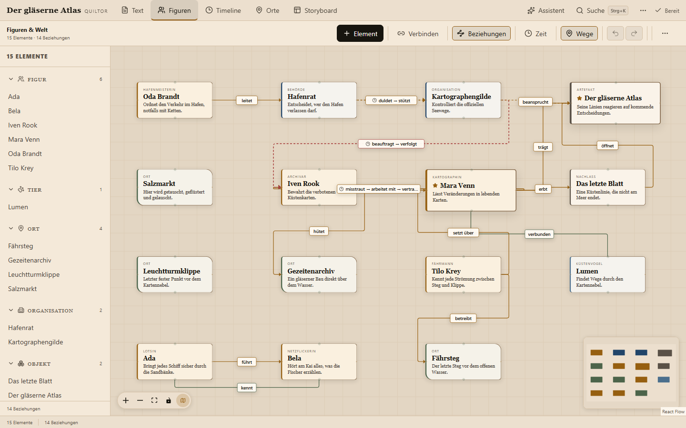

### Timeline

Am gewählten Zeitpunkt zeigt der Graph, wer zusammenarbeitet und wer sich wo aufhält. Rückblenden im Manuskript verschieben die Chronologie der Welt nicht.

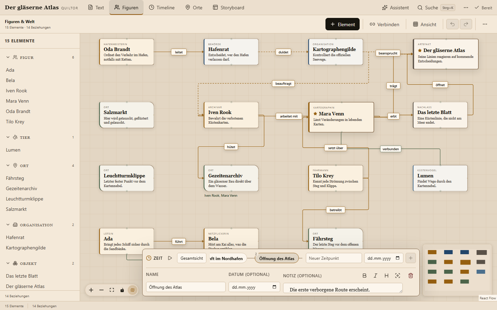

Die Timeline-Seite pflegt Zeitpunkte, Notizen, Beziehungszustände und Lebensereignisse. Jeder Zeitpunkt zeigt, welche Kapitel ihn verwenden.

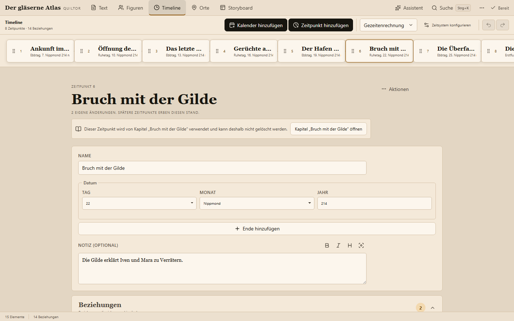

Neben relativer Zeit und gregorianischen Daten gibt es eigene Kalender mit benannten Monaten, Wochentagen und Epoche. Ein Kalenderwechsel ändert die Reihenfolge der Ereignisse nicht.

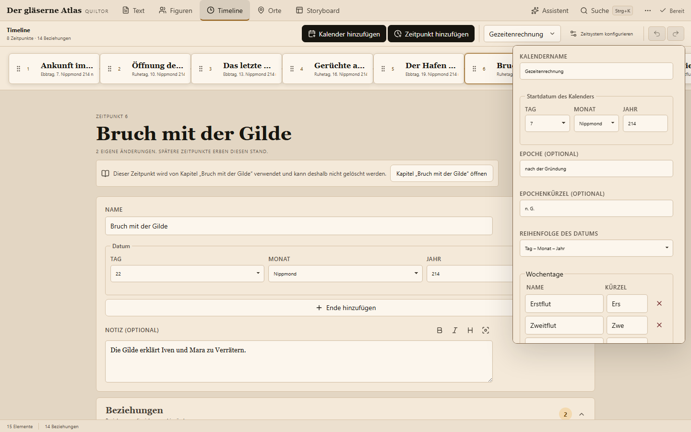

### Orte und Karten

Orte stehen auf einer eigenen Karte, ein Lineal misst Distanzen in deinem Maßstab. Aus der Timeline entstehen Aufenthaltschroniken und Reiseverläufe.

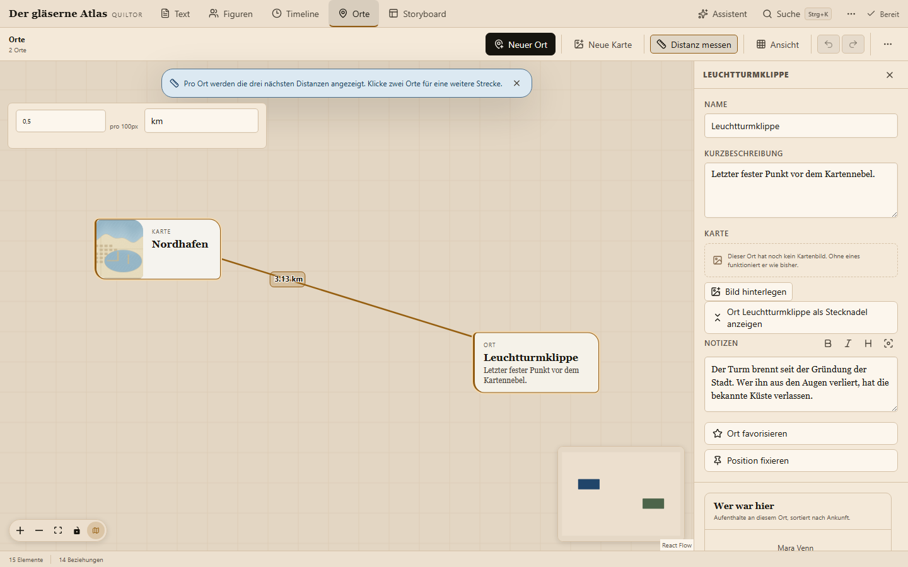

Jeder Ort ist zugleich eine Ebene. Auf ein eigenes Kartenbild, etwa einen Stadtplan, setzt du die Orte darin als Stecknadeln oder Karten.

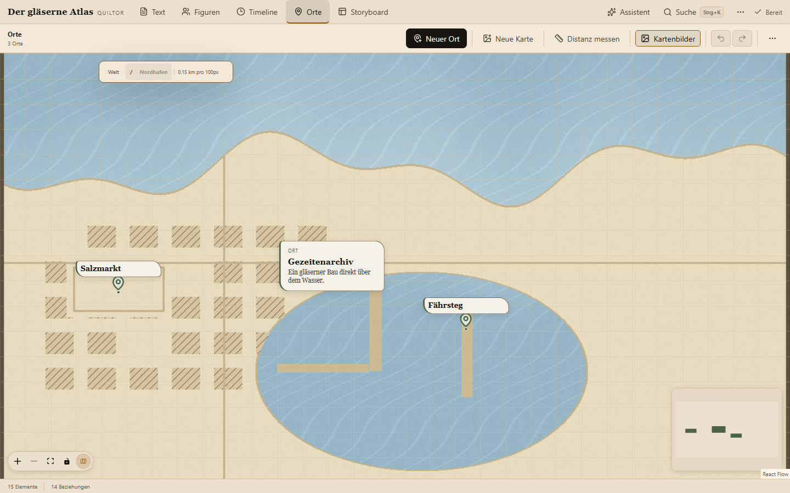

### Storyboard

Mehrere Boards mit Notizen, Referenzkarten, Gruppen und Verbindungen. Planung bleibt Planung: Eine Verbindung auf dem Board erzeugt keine Beziehung in der Welt.

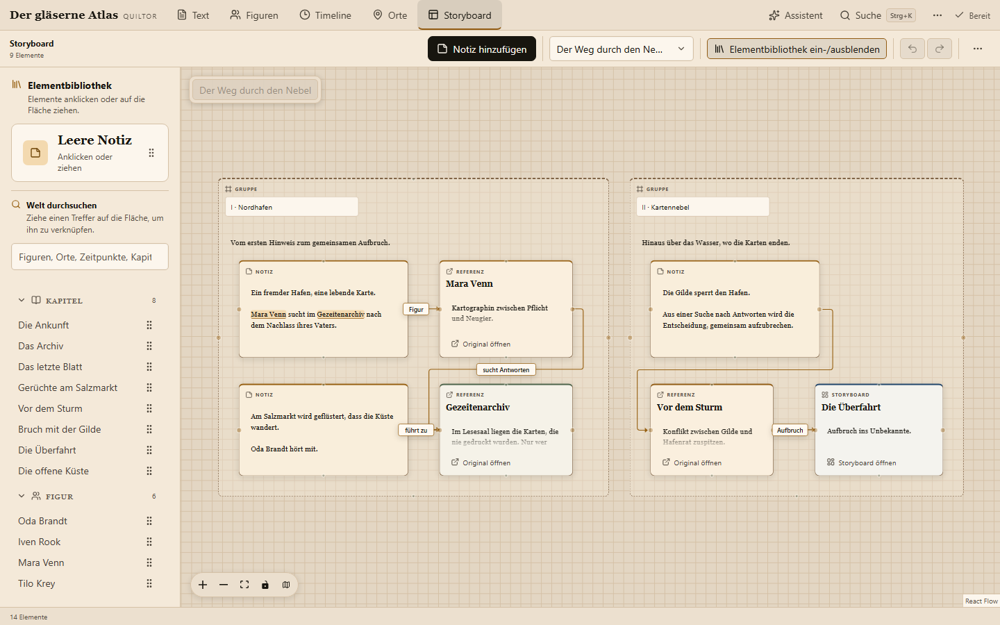

### Eine Notiz überall

Kapitel, Weltelemente, Zeitpunkte und Storyboard-Karten nutzen denselben Notizeditor. Verweise mit `@` überstehen Umbenennungen, Backlinks zeigen, wo etwas verwendet wird.

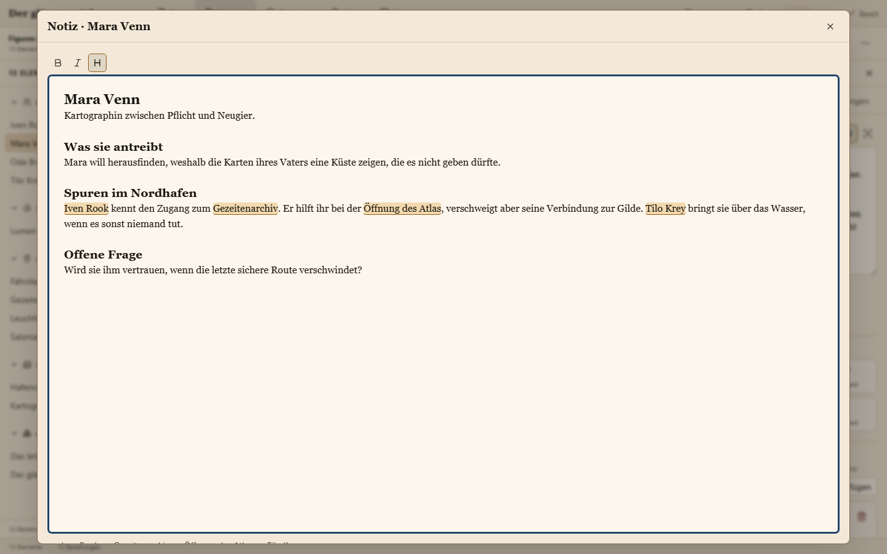

### Suche

Eine Suche über Kapitel, Text, Notizen, Figuren, Orte, Zeitpunkte und Storyboards. Treffer zeigen ihren Ordner und die Fundstelle im Text.

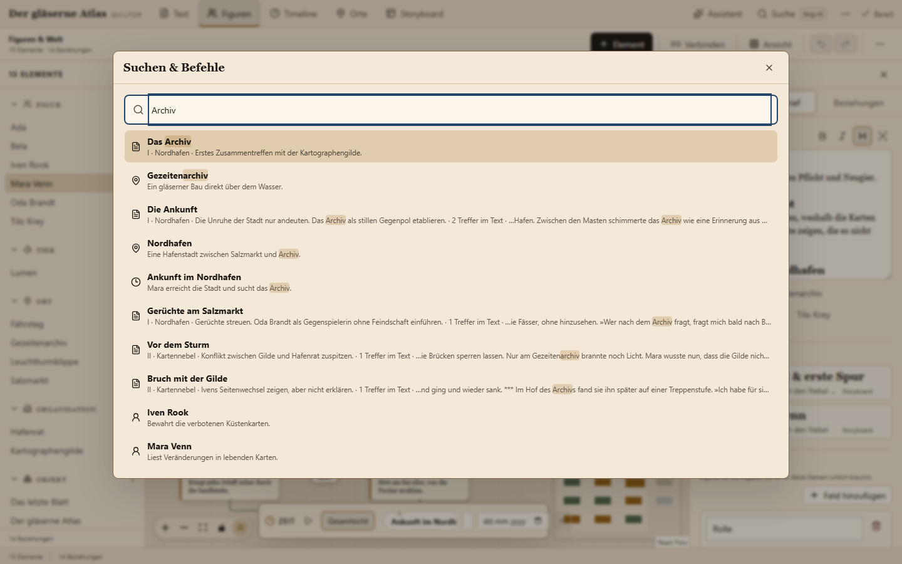

### Versionen

Du hältst Versionen mit einer kurzen Notiz fest und vergleichst sie wortweise mit dem aktuellen Stand. Jede Version lässt sich wiederherstellen.

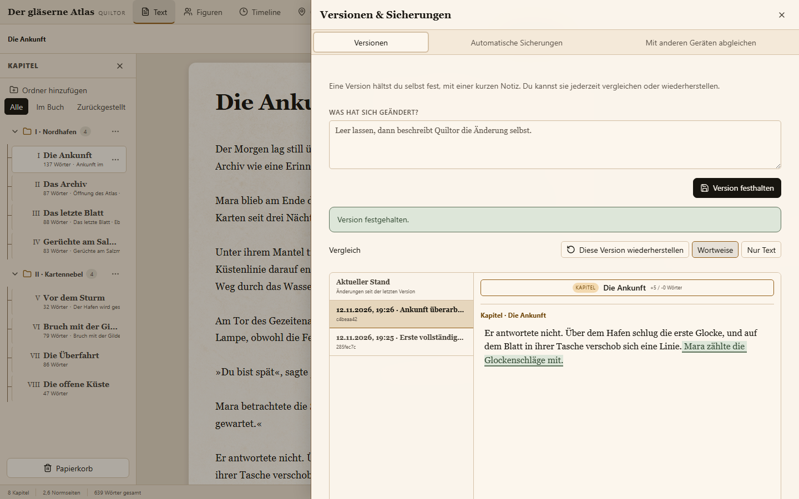

## Schnellstart

> [!TIP]
> Am schnellsten ausprobiert: **[quiltor.app](https://quiltor.app)** im Browser öffnen.

- **Im Browser:** [quiltor.app](https://quiltor.app) öffnen und eine neue Welt anlegen. Die Projektdaten liegen dann auf diesem Server.
- **Desktop-App:** Das Paket für macOS (Apple Silicon) oder Windows aus den [Releases](https://github.com/Tim3399/quiltor/releases) laden. Die [ersten Schritte](https://github.com/Tim3399/quiltor/blob/main/docs/ERSTE-SCHRITTE.md) führen durch Installation und erste Aufgaben.
- **Selbst betreiben:** mit Python 3.12+ aus dem Quellcode oder mit Docker. Details stehen unter [Installation und Betrieb](https://github.com/Tim3399/quiltor/blob/main/docs/betrieb/installation.md).

```bash
git clone https://github.com/Tim3399/quiltor.git
cd quiltor
python3 apps/web/server.py
```

Quiltor öffnet dann `http://localhost:8000`. Unter Windows: `py -3.12 apps/web/server.py`. Der Start lädt kein Modell; den Assistenten richtest du später ausdrücklich ein.

## Deine Daten

Im lokalen Betrieb bleibt alles auf deinem Rechner: Jede Welt ist eine eigene SQLite-Datenbank mit automatischen Sicherungen und Versionsverlauf. Ein Abgleich mit anderen Geräten läuft nur auf deinen Klick und nur über einen Backup-Endpunkt, den du einträgst, zum Beispiel `https://backup.quiltor.app`. Was wo liegt, beschreibt [Sync, Backup und lokale Daten](https://github.com/Tim3399/quiltor/blob/main/docs/betrieb/sync-und-backup.md).

## Für wen

Für Autorinnen und Autoren, die selbst schreiben und keinen KI-Ghostwriter suchen. Besonders für lange Romane und Serien mit vielen Figuren, Orten und Zeitebenen.

## Weiterlesen

- [Erste Schritte](https://github.com/Tim3399/quiltor/blob/main/docs/ERSTE-SCHRITTE.md)
- [Funktionen im Detail](https://github.com/Tim3399/quiltor/blob/main/docs/funktionen.md)
- [Installation und Betrieb](https://github.com/Tim3399/quiltor/blob/main/docs/betrieb/installation.md): Quellcode, Python-Paket, Desktop, Docker, CLI
- [Der lokale Assistent](https://github.com/Tim3399/quiltor/blob/main/docs/assistent.md): Runtime, externer Endpunkt, MCP
- [Eigene KI](https://github.com/Tim3399/quiltor/blob/main/docs/betrieb/eigene-ki.md): KI im Browser (WebLLM) statt Server-KI, Schalter, Fristen, Reverse-Proxy und Content-Security-Policy
- [Deutsche Schreibwerkzeuge](https://github.com/Tim3399/quiltor/blob/main/docs/schreibwerkzeuge.md)
- [Sync, Backup und lokale Daten](https://github.com/Tim3399/quiltor/blob/main/docs/betrieb/sync-und-backup.md)
- [Entwicklung](https://github.com/Tim3399/quiltor/blob/main/docs/development.md) und [Architektur](https://github.com/Tim3399/quiltor/blob/main/docs/architecture/overview.md) (englisch)
- [Roadmap](https://github.com/Tim3399/quiltor/blob/main/docs/TODO.md)

## Status und Lizenz

Quiltor befindet sich in aktiver Entwicklung. Die fünf Arbeitsbereiche sind umgesetzt;
tiefere Quellen- und Herkunftsnachweise, dauerhafte Befunde, inkrementelle Analyse und eigene
KI-Abläufe für das Storyboard stehen in der [Roadmap](https://github.com/Tim3399/quiltor/blob/main/docs/TODO.md).

Quiltor ist **source-available, nicht Open Source**. Der Quelltext ist öffentlich einsehbar, veränderbar und weitergebbar; kommerzielle Nutzung durch größere Organisationen ist eingeschränkt.

Es gilt wahlweise:

- [PolyForm Noncommercial License 1.0.0](https://polyformproject.org/licenses/noncommercial/1.0.0)
- [PolyForm Small Business License 1.0.0](https://polyformproject.org/licenses/small-business/1.0.0)

Siehe [LICENSE](LICENSE).

### Kostenlos ohne Rückfrage

- nicht-kommerzielle Nutzung: private Projekte, Hobby, Studium, Lehre, Forschung, gemeinnützige Organisationen und öffentliche Einrichtungen
- kommerzielle Nutzung im Rahmen der PolyForm Small Business License: weniger als 100 Mitarbeitende/freie Mitarbeitende und weniger als 1.000.000 USD Umsatz im vorherigen Steuerjahr

Selbstständige Autorinnen und Autoren fallen praktisch immer unter diese Small-Business-Grenze.

Für kommerzielle Nutzung oberhalb dieser Grenze ist eine individuelle Vereinbarung erforderlich:

**<tim.ratermann@outlook.de>**

Details: [COMMERCIAL.md](COMMERCIAL.md)

Die Zusammenfassung ist unverbindlich; maßgeblich ist der englische Lizenztext in [LICENSE](LICENSE).

Release-Pakete enthalten zusätzlich Software und Modellgewichte Dritter unter eigenen Lizenzen. Siehe [THIRD-PARTY-NOTICES.md](THIRD-PARTY-NOTICES.md).
