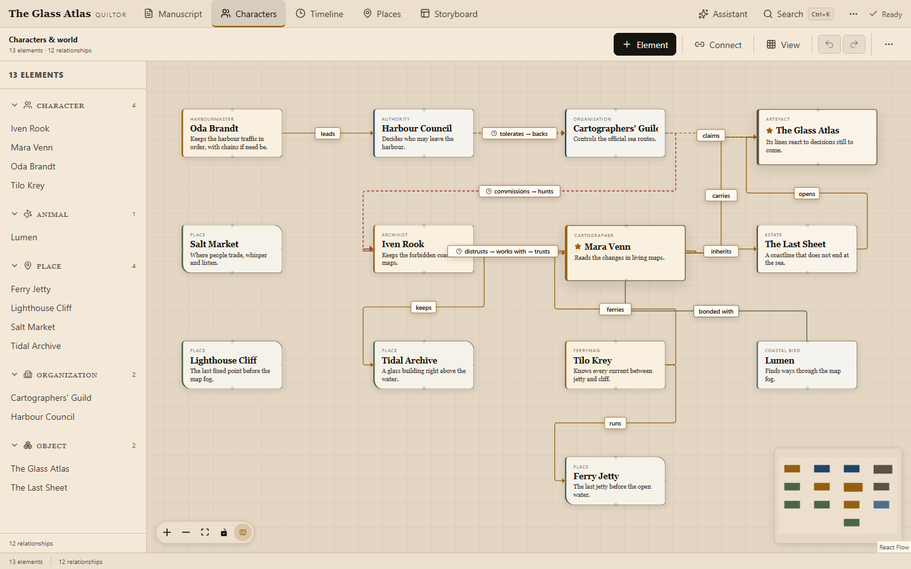
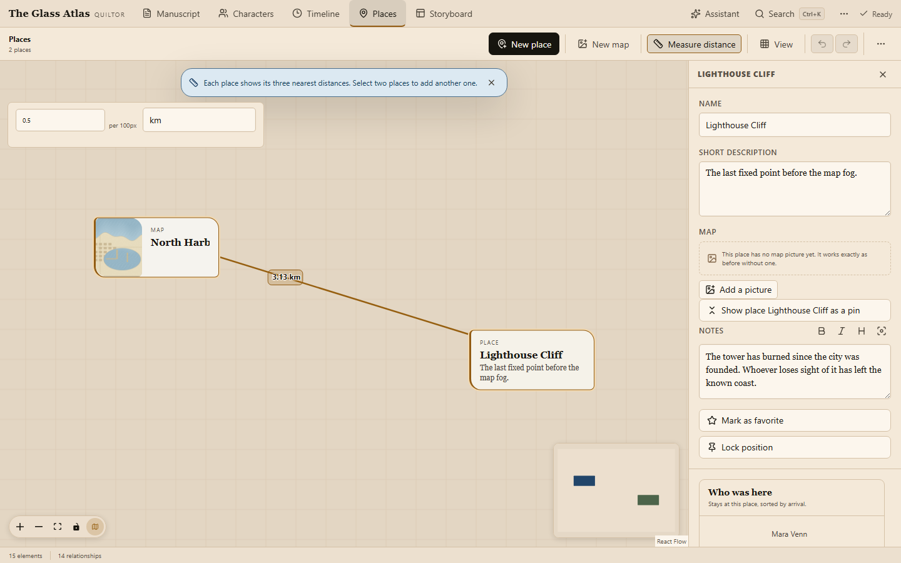
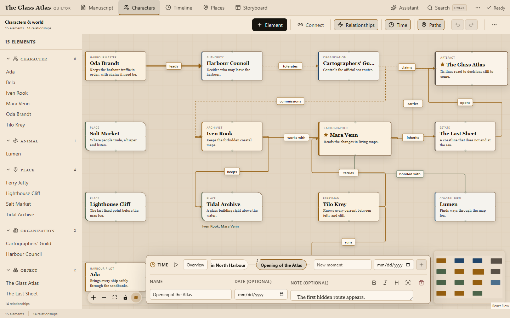
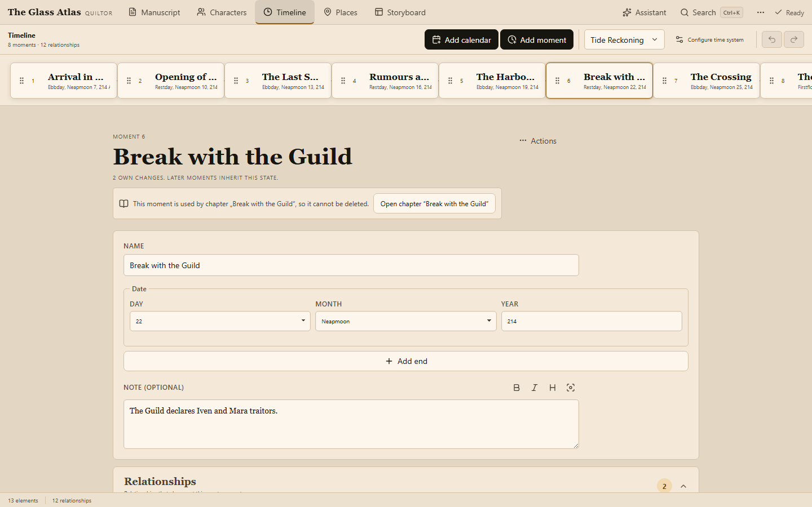
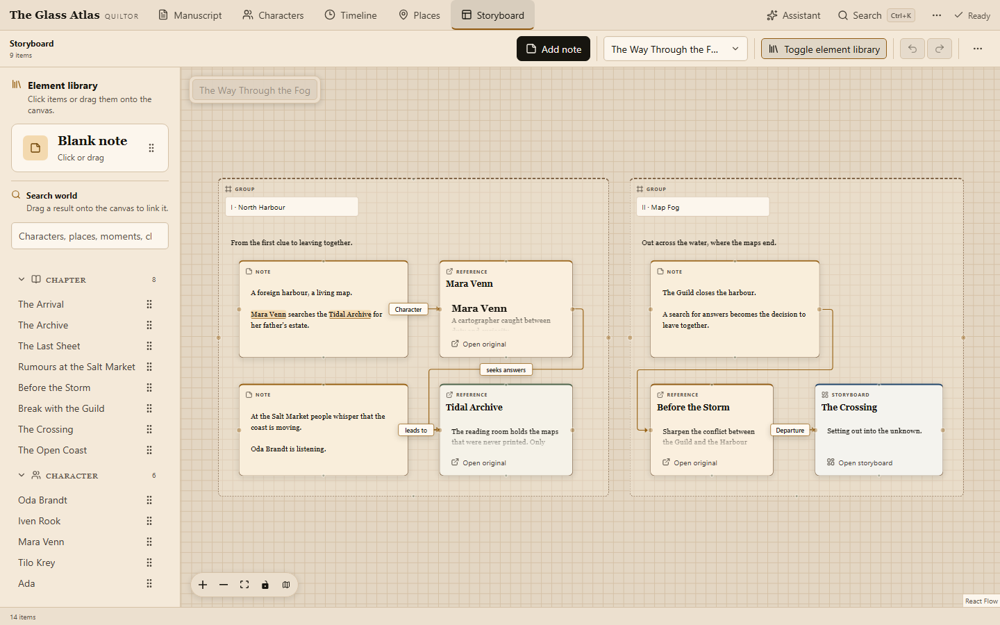
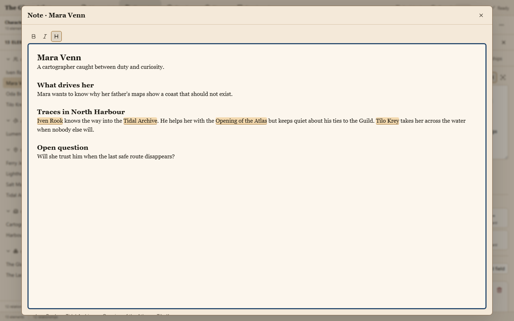

# Features

What Quiltor does today, view by view. The short version with pictures is in the [README](../README.en.md).

## What is included today

[`VERSION`](../VERSION) is the current version authority. This overview describes the source tree.

| Area                 | Capabilities                                                                                                                                                       |
| -------------------- | ------------------------------------------------------------------------------------------------------------------------------------------------------------------ |
| Manuscript           | Chapter editor, nested folders, drag-and-drop ordering, boundary-scroll navigation, focus mode, story-time anchors, book PDF depending on the host                 |
| Characters and world | Element types, profiles with optional fields, aliases, relationship graph, directed and temporal relationships, minimap, important and pinned elements             |
| Places               | Dedicated map, imported map images, free placement, configurable distance scale, distance measurement, stay and journey chronicles                                 |
| Timeline             | Signed relative time, simultaneous events, Gregorian and custom calendars, presence, relationship states, life events, graph playback                              |
| Storyboard           | Multiple linked boards, note, reference, board and group cards, connections, drag-and-drop search results, resizing, layer ordering                                |
| Notes and navigation | Shared formatting and focus mode, stable `@` references, backlinks, cross-workspace search                                                                         |
| Assistance           | Local language model, citations, world discovery from the manuscript, name and alias resolution, proposals, batches, read-only planning context, proposal-only MCP |
| Writing tools        | Local German dictionary, synonyms, word translation, spelling and grammar aids                                                                                     |
| Storage              | Per-world SQLite, autosave, revision checks, undo/redo, local history, snapshots, optional authenticated remote backup                                             |

The interface ships German and English language packs. The installable dictionary, grammar and translation aids currently target the writing language `de-DE`.

## One world instead of scattered notes

Quiltor does not treat worldbuilding as a pile of unrelated text fields. Characters, places, relationships, and timeline share the same underlying world.

### Manuscript: write without the interface getting in the way

The chapter editor stays quiet and gives the prose room. Focus mode, undo/redo, formatted chapter notes, local history, discreet writing aids, and one-word autocomplete support the writing process without taking it over.

Chapters and folders form a nested binder. Drag chapters or whole folders to change their reading order, collapse branches, and follow folder breadcrumbs in search results. The resulting reading order also applies to search, export and assistant analyses. Continued scrolling at a chapter boundary reveals the previous or next chapter; an explicit navigation action is available as well.

Each chapter can refer to a story-time moment or range independently of its position in the book. Flashbacks and parallel scenes keep their place in the manuscript without changing the world's chronology. Linked mentions lead to the world elements they name; after a rename, the author confirms explicitly whether to update them in the manuscript.

A readable 6 × 9 inch book PDF can be exported from the manuscript.

### Characters and relationships: see what belongs together

Characters and other world elements live in a visual graph. Relationships may be directed or undirected, change meaning, start, or end.

The graph is not a second copy of your data: timeline, relationships, and elements use the same state.

Profiles start with a freely editable note. Suggested and custom fields are optional; aliases map different names to the same character.

### Places: understand the world spatially

Places have their own map and can be positioned freely, independently from their position in the world graph.

A ruler measures distances between places and converts them through an adjustable scale into your own units.

Timeline presence data automatically produces:

- a stay chronicle for each place
- a journey history for each character
- temporal gaps between moves

### Timeline: the world changes

Stories are not static. A friendship can break, a character can move, an object can become important, and a character can die.

Quiltor models those changes along the timeline instead of storing only the latest state.

The dedicated timeline workspace is built for maintenance: order moments, add notes, change relationship states, and mark life events. Signed relative time supports events before and after a chosen origin, including simultaneous events. Gregorian and custom calendar projections, with named months and weekdays, give the same timeline readable dates without making chapter order its clock. Switching the calendar does not change the underlying chronology. The world state at a moment is computed deterministically from the recorded facts.

### Storyboard: room for unfinished ideas

Storyboard is the fifth workspace. Create multiple boards, pan and zoom, and arrange resizable **note**, **reference**, **board**, and **group** cards. Connect cards, control their front-to-back order, and navigate linked boards through breadcrumbs.

Search for a figure, place, timeline moment, chapter, or board and drag the result onto the canvas. The card links to the original object; opening it returns to the corresponding workspace. Notes can be edited directly on the canvas or in the shared notes focus mode. Autosave and undo/redo cover storyboard changes independently.

Storyboard text and connections are planning material. Saving an idea does not create a canonical relationship, presence assignment, or timeline fact.

### Shared notes and references

Chapter notes, world notes, timeline moment notes, and storyboard notes share bold, italic, headings, and a focused editing view. Type `@` to link an existing project object. References use stable IDs, so navigation and backlinks can still find the source after an object is renamed or a chapter moves to another folder.

Profiles and other reference targets show where they are mentioned, including the exact storyboard card. Search and assistant retrieval retain the underlying plain text alongside formatting and reference metadata.

