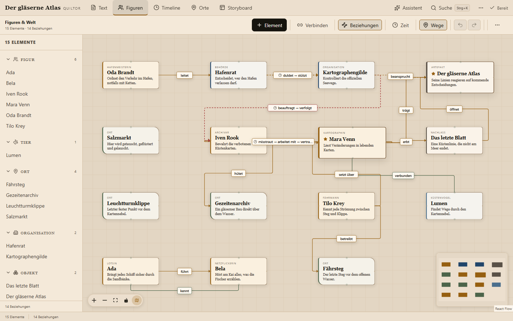
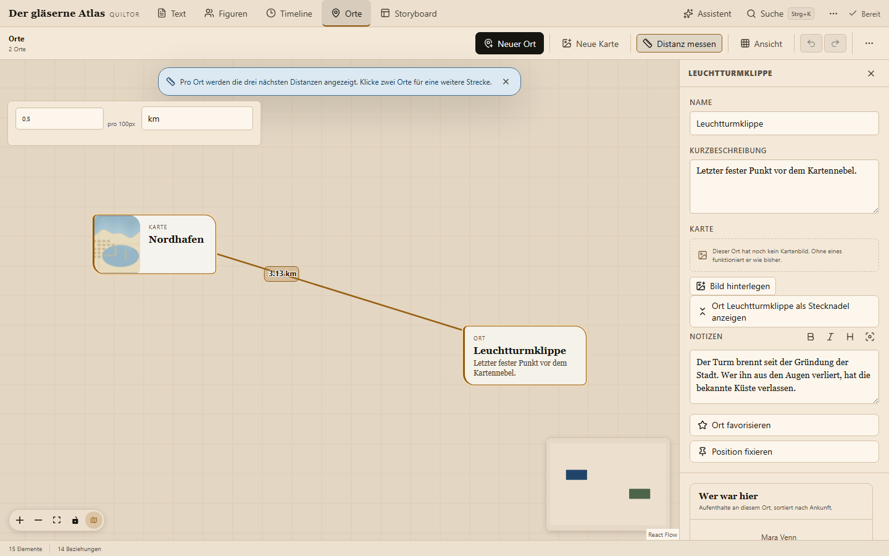
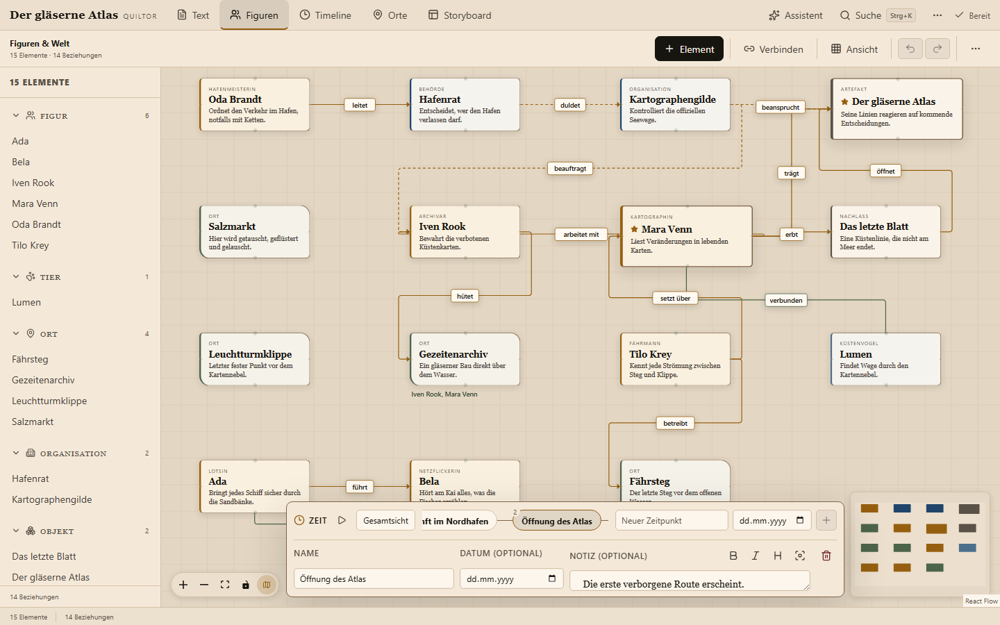
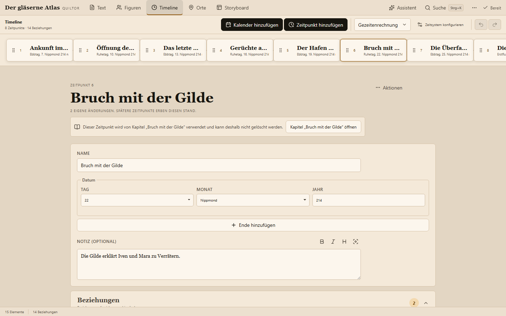
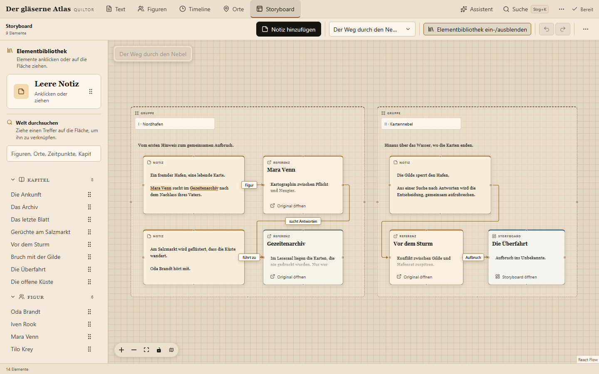
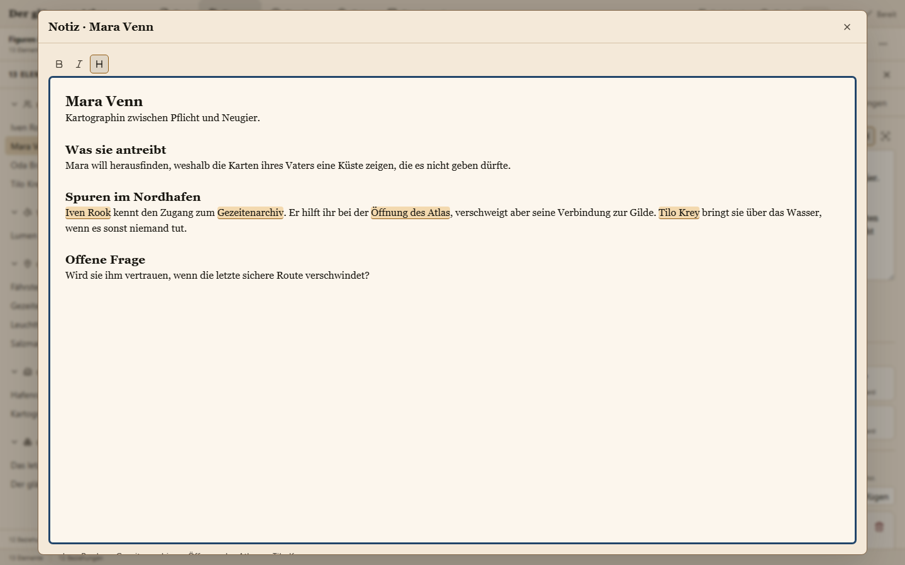

# Funktionen

Was Quiltor heute kann, Ansicht für Ansicht. Die Kurzfassung mit Bildern steht in der [README](../README.md).

## Was heute enthalten ist

Die aktuelle Versionsquelle ist [`VERSION`](../VERSION). Diese Übersicht beschreibt den Quellstand.

| Bereich                | Enthalten                                                                                                                                                                               |
| ---------------------- | --------------------------------------------------------------------------------------------------------------------------------------------------------------------------------------- |
| Manuskript             | Kapitel-Editor, verschachtelte Ordner, Drag-and-drop, Kapitelwechsel durch Weiterscrollen, Fokusmodus, Zeitanker, Buch-PDF je nach Host                                                 |
| Figuren und Welt       | Elementtypen, Profile mit optionalen Feldern, Aliasse, Beziehungsgraph, gerichtete und zeitabhängige Beziehungen, Übersichtskarte, wichtige und fixierte Elemente                       |
| Orte                   | Eigene Kartenansicht, importierte Kartenbilder, freie Platzierung, einstellbarer Maßstab, Distanzmessung, Aufenthalts- und Reisechroniken                                               |
| Timeline               | Relative Zeit mit Vorzeichen, gleichzeitige Ereignisse, gregorianische und eigene Kalender, Anwesenheit, Beziehungszustände, Lebensereignisse, Playback im Graphen                      |
| Storyboard             | Mehrere verknüpfte Boards, Notiz-, Referenz-, Board- und Gruppenkarten, Verbindungen, Suchtreffer per Drag-and-drop, Größenänderung, Ebenenreihenfolge                                  |
| Notizen und Navigation | Formatierte Notizen und Fokusmodus, stabile `@`-Referenzen, Backlinks, Suche über alle Arbeitsbereiche                                                                                  |
| Assistenz              | Lokales Sprachmodell, Quellen, Weltanalyse aus dem Manuskript, Namens- und Aliasauflösung, prüfbare Vorschläge, Batch-Verarbeitung, Planungskontext nur lesend, MCP nur mit Vorschlägen |
| Schreibwerkzeuge       | Lokales deutsches Wörterbuch, Synonyme, Wortübersetzung, Rechtschreib- und Grammatikhilfen                                                                                              |
| Speicherung            | SQLite je Welt, Autosave, Revisionsprüfung, Undo/Redo, lokaler Verlauf, Sicherungen, optionales angemeldetes Remote-Backup                                                              |

Die Oberfläche enthält deutsche und englische Sprachpakete. Die installierbaren Wörterbuch-, Grammatik- und Übersetzungshilfen sind derzeit auf die Schreibsprache `de-DE` ausgerichtet.

## Eine Welt statt verstreuter Notizen

Quiltor behandelt Weltwissen nicht als lose Sammlung von Textfeldern. Figuren, Orte, Beziehungen und Timeline hängen zusammen und verwenden dieselben Daten.

### Manuskript: ruhig schreiben

Der Kapitel-Editor hält sich zurück und gibt dem Text Platz. Fokusmodus, Undo/Redo, Kapitelnotizen, Versionsverlauf, diskrete Schreibhilfen und Ein-Wort-Autocomplete unterstützen den Schreibprozess, ohne ihn zu übernehmen.

Kapitel und verschachtelte Ordner lassen sich per Drag-and-drop ordnen. Zweige lassen sich einklappen, und Suchtreffer zeigen den Ordnerpfad. Die daraus entstehende Lesereihenfolge gilt auch für Suche, Export und Assistentenanalysen. Am Kapitelanfang oder -ende führt bewusstes Weiterscrollen zum vorherigen oder nächsten Kapitel; die Übergänge sind auch anklickbar.

Kapitel können einen Zeitpunkt oder Zeitraum der Geschichte referenzieren. Rückblenden und parallele Szenen behalten ihren Platz im Buch und verändern dadurch nicht die Reihenfolge der Welt-Timeline. Verknüpfte Erwähnungen führen zu den zugehörigen Weltelementen; nach einer Umbenennung kann der Autor ihre Aktualisierung im Manuskript ausdrücklich bestätigen.

Das fertige Manuskript kann als lesbares Buch-PDF im 6 × 9-Zoll-Format ausgegeben werden.

### Figuren und Beziehungen: sehen, was zusammengehört

Figuren und andere Weltelemente leben in einem visuellen Graphen. Beziehungen können gerichtet oder ungerichtet sein, ihre Bedeutung ändern, beginnen oder enden.

Der Graph ist keine separate Kopie deiner Daten: Timeline, Beziehungen und Elemente greifen auf denselben Zustand zu.

Profile beginnen mit einer frei bearbeitbaren Notiz. Empfohlene und selbst benannte Felder sind optional; Aliasse helfen dabei, unterschiedliche Namen derselben Figur zuzuordnen.

### Orte: die Welt räumlich verstehen

Orte bekommen eine eigene Kartenansicht und können frei positioniert werden – unabhängig davon, wo sie im Weltgraphen liegen.

Ein Lineal misst Distanzen zwischen Orten und rechnet sie über einen frei einstellbaren Maßstab in deine eigenen Einheiten um.

Aus den Präsenzdaten der Timeline entstehen automatisch:

- Aufenthaltschroniken pro Ort
- Reiseverläufe pro Figur
- zeitliche Abstände zwischen Ortswechseln

### Timeline: Beziehungen und Weltzustand verändern sich

Geschichten sind nicht statisch. Eine Freundschaft kann zerbrechen, eine Figur kann umziehen, ein Objekt kann relevant werden und eine Figur kann sterben.

Quiltor modelliert solche Änderungen entlang der Timeline, statt nur den letzten Zustand zu speichern.

Die eigenständige Timeline-Seite ist für die Pflege optimiert: Zeitpunkte sortieren, Notizen hinterlegen, Beziehungszustände verändern und Lebensereignisse markieren.

Zeitpunkte liegen auf einer gemeinsamen relativen Zeitachse, auch vor dem Ursprung und gleichzeitig mit anderen Ereignissen. Die Anzeige unterstützt relative Zeit, gregorianische Daten und eigene Kalender mit benannten Monaten und Wochentagen. Ein Kalenderwechsel verändert die zugrunde liegende Chronologie nicht. Der Weltzustand zu einem Zeitpunkt wird deterministisch aus den hinterlegten Fakten berechnet.

### Storyboard: Ideen planen und miteinander verbinden

Das Storyboard ist der fünfte Arbeitsbereich. Mehrere Boards bieten Platz für frei verschiebbare und skalierbare Notizkarten, Referenzkarten, Verbindungen und Gruppenrahmen. Über die Ebenensteuerung lässt sich die Überlagerung der Karten ändern.

Die integrierte Weltsuche findet Figuren, Orte, Zeitpunkte, Kapitel und andere Boards. Suchtreffer lassen sich auf die Fläche ziehen und von dort im ursprünglichen Arbeitsbereich öffnen. Boards können auf weitere Boards verweisen; eine Breadcrumb-Navigation zeigt den Weg. Notizen lassen sich direkt auf der Fläche oder im gemeinsamen Fokusmodus bearbeiten. Boards lassen sich verschieben und zoomen. Storyboards besitzen eigenes Undo/Redo und Autosave.

**Planung bleibt Planung:** Eine Verbindung auf dem Storyboard erzeugt keine Beziehung, keine Anwesenheit und keinen Timeline-Fakt in der erzählten Welt. Ideen und Notizen werden nicht automatisch zu gesicherten Weltfakten.

### Gemeinsame Notizen, Referenzen und Backlinks

Kapitel, Weltelemente, Zeitpunkte und Storyboard-Karten verwenden denselben Notizeditor mit Formatierung und Fokusmodus. Mit `@` lassen sich bestehende Inhalte suchen und verlinken. Die Referenzen speichern stabile IDs und überstehen Umbenennungen und das Verschieben eines Kapitels in einen anderen Ordner; Backlinks zeigen, wo ein Inhalt bereits verwendet wird, bis hin zur einzelnen Storyboard-Karte.

Suche und Assistent lesen den reinen Text zusammen mit Formatierung und Referenzen.

